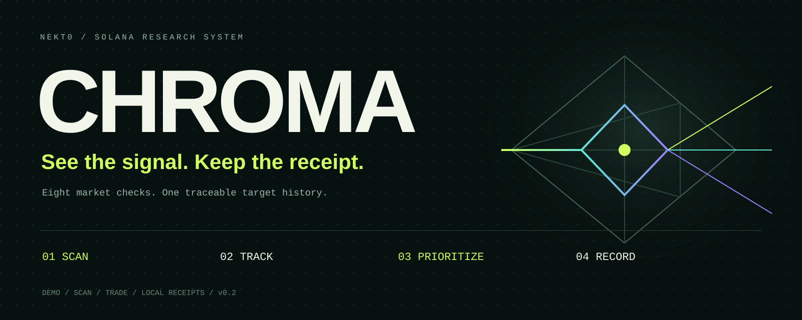
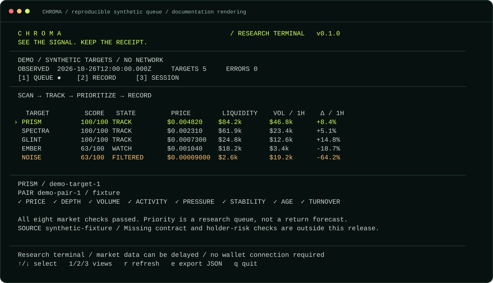
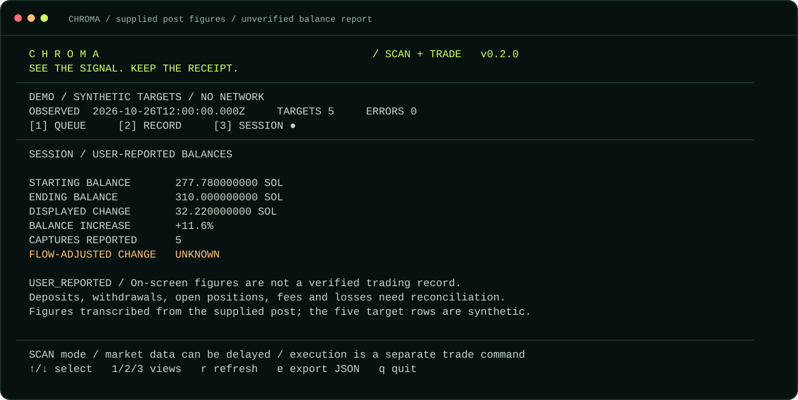

<p align="center"></p>

<p align="center">
  
  
  
  
  <a href="LICENSE"></a>
</p>

<p align="center"><strong>A Solana research terminal that remembers why a target entered the queue.</strong><br>Public market snapshots → eight explainable checks → ranked candidates → a local event record.</p>

<p align="center"><a href="#run-in-30-seconds">Run locally</a> · <a href="#the-terminal">Terminal</a> · <a href="#eight-checks-you-can-inspect">Checks</a> · <a href="docs/COMMANDS.md">Commands</a> · <a href="docs/METHODOLOGY.md">Methodology</a> · <a href="docs/README.ru.md">Русский</a></p>

## Why CHROMA

A balance chart says where a session ended. It rarely explains what entered the queue, why it mattered, or what changed while it was being tracked.

CHROMA puts the target, its estimated market values, its tracking status and its observations in one workflow. Every saved snapshot includes the measurements, the rule thresholds and the status transition. Provider failures are recorded too.

**v0.2 supports DEMO, SCAN and TRADE.** SCAN reads DEX Screener market data and maintains the research queue. TRADE adds Jupiter quotes, unsigned transaction simulation and explicit mainnet swap execution with a local wallet. DEMO remains an independent walkthrough with five synthetic targets.

| Mode | What it does |
| --- | --- |
| **DEMO** | Runs synthetic snapshots offline. |
| **SCAN** | Reads live markets, ranks candidates and records observations. |
| **TRADE** | Previews and simulates Jupiter swaps; `--execute` enables signing and submission after per-order confirmation. |

## Run in 30 seconds

Install [Node.js 22+](https://nodejs.org/), then:

```bash
git clone https://github.com/Nekt-0/CHROMA.git
cd CHROMA
node src/cli.mjs demo
```

The scanner and demo need no package installation, API keys or wallet. In an interactive terminal, `demo` opens the full-screen interface. For a static printout:

```bash
node src/cli.mjs demo --once
node src/cli.mjs demo --json
```

If npm is available, `npm start`, `npm run demo`, `npm test` and `npm run check` are shortcuts. The direct Node commands work without npm.

## The terminal



The image is a documentation rendering of the actual CLI renderer, generated by [`scripts/brand.mjs`](scripts/brand.mjs). Target names and market values are synthetic; it is not a captured live session or the original video.

| Job | What CHROMA does |
| --- | --- |
| **SCAN** | Discovers recent Solana token profiles or reads the public mints you supply. |
| **TRACK** | Repeats snapshots and records changes in status and reference price. |
| **PRIORITIZE** | Orders candidates using visible market checks and liquidity. |
| **RECORD** | Saves snapshots, rules, provider errors, notes and reported balances to a local hash-linked journal. |

Use **↑ / ↓** or **j / k** to select a target, **1 / 2 / 3** for queue / record / session, **r** to refresh, **e** to export JSON and **q** to quit. A terminal around 110 columns × 36 rows shows the full queue. Smaller windows use a compact view.

## Read live Solana data

```bash
# Health check, including one public provider request
node src/cli.mjs doctor --probe

# One sweep over up to five recently profiled Solana tokens
node src/cli.mjs scan --discover --limit 5

# Full-screen queue, refreshed every 30 seconds
node src/cli.mjs watch --discover --interval 30
```

For a stable watchlist, supply token mint addresses:

```bash
# Wrapped SOL is an address-format and provider example, not a suggested target.
node src/cli.mjs scan --tokens So11111111111111111111111111111111111111112 --json
node src/cli.mjs watch --tokens So11111111111111111111111111111111111111112
```

CHROMA selects the deepest eligible **base-token** pair by reported USD liquidity. It does not average unrelated pools or use a quote-side token's base price. If the selected pair changes, the event is labelled `PAIR_CHANGED` and the cross-pool price delta is suppressed.

Discovery follows the provider's latest profiles. It is a bounded, potentially promoted subset, not a complete feed of new mints. Public data may lag, be incomplete or be manipulated. [Provider API reference](https://docs.dexscreener.com/api/reference).

## Execute real swaps

Install the trading SDK with pnpm 11.25.0:

```bash
pnpm install --frozen-lockfile --ignore-scripts

# Public quote: 0.001 SOL → USDC, no wallet or signature
node src/cli.mjs quote --amount-sol 0.001 --output-mint EPjFWdd5AufqSSqeM2qN1xzybapC8G4wEGGkZwyTDt1v
```

For an unsigned preview, add your public address:

```bash
node src/cli.mjs trade --taker YOUR_PUBLIC_ADDRESS --amount-sol 0.001 --output-mint EPjFWdd5AufqSSqeM2qN1xzybapC8G4wEGGkZwyTDt1v
```

For execution, use a local Solana CLI keypair file and explicitly enable submission:

```bash
node src/cli.mjs trade --wallet /absolute/path/to/id.json --amount-sol 0.001 --output-mint EPjFWdd5AufqSSqeM2qN1xzybapC8G4wEGGkZwyTDt1v --execute
```

The command displays the exact mints, atomic token amounts, minimum output, price impact and fee estimates. It inspects the assembled transaction, simulates it on mainnet and asks you to type `SWAP` followed by the wallet's displayed suffix. An expired order must be reviewed again. Scanning never triggers an order automatically.

Defaults are 50 bps slippage, 5% maximum quoted price impact, 100 bps maximum token fee, 10,000 lamports maximum encoded priority fee and 5,000,000 lamports maximum **quoted** SOL fees including rent. These are configurable checks, not guarantees about future prices or an external provider's estimates. Minimum output is reported before any separately collected token fee.

This implementation supports self-funded **v0 Metis** routes using the reviewed Jupiter `route` and `sharedAccountsRoute` instruction layouts. Other routers, gasless orders, extra signers, unsupported instructions and unexpected token destinations are rejected. Some otherwise valid Jupiter routes will therefore be unavailable.

Use `JUPITER_API_KEY` if Jupiter requires authenticated access, `SOLANA_RPC_URL` for your HTTPS mainnet RPC, and optionally `CHROMA_WALLET` for a local keypair path. [`.env.example`](.env.example) documents the variables; Node can load a local file with `--env-file=.env`.

Every submission attempt records its signature **before** the network request. An ambiguous timeout stays `UNKNOWN`; the code never retries the submission automatically. Reconcile with:

```bash
node src/cli.mjs trade-status --signature YOUR_TRANSACTION_SIGNATURE
```

Public quote access has been checked against Jupiter. Signing, rejection paths and submission recovery are covered by mocked tests; no funded mainnet trade was performed during development. [Trading reference and setup](docs/TRADING.md).

## Eight checks you can inspect

| Check | Default pass condition |
| --- | --- |
| **PRICE** | A positive USD reference price exists. |
| **DEPTH** | Reported liquidity ≥ $10,000. |
| **VOLUME** | Reported one-hour volume ≥ $5,000. |
| **ACTIVITY** | At least 40 one-hour swaps. |
| **PRESSURE** | Buys represent at least 52% of one-hour swap count. |
| **STABILITY** | Absolute one-hour price change ≤ 40%. |
| **AGE** | The selected pair is between 10 minutes and 72 hours old. |
| **TURNOVER** | One-hour volume / current liquidity is between 0.1 and 10. |

Every pass contributes 12.5 points. The displayed score is rounded; **TRACK** starts at 75 and **WATCH** at 50. A failed price or liquidity gate gives **FILTERED** regardless of score. Missing measurements give **INCOMPLETE**. A provider failure marks a previously seen target **UNAVAILABLE** in the reconstructed history.

These are transparent defaults for organizing research, not validated predictors of returns. Buy count is not capital flow; pool age is not mint age. Contract authorities, holder concentration, bundles and sellability are not checked in v0.1. [Full methodology](docs/METHODOLOGY.md) · [Thresholds](src/config.mjs).

## A session claim with its context

The supplied post reports:

| Displayed metric | Reported value |
| --- | ---: |
| Starting balance | 277.78 SOL |
| Ending balance | 310.00 SOL |
| Displayed balance change | +32.22 SOL |
| Balance increase, rounded | +11.6% |
| Captures | 5 |

**These are user-supplied on-screen figures, not verified trading performance.** The original video, wallet addresses, transaction receipts, individual target identities and fills are not included in this repository. The five demo rows illustrate the interface and are not a reconstruction of those captures.



Record your own reported balances with:

```bash
node src/cli.mjs session --start 277.78 --end 310 --captures 5
```

SOL arithmetic uses integer lamports. The example computes exactly `32.220000000 SOL` and rounds the balance increase to `11.6%`. If deposits and withdrawals are known, supply both with `--deposits` and `--withdrawals` to compute a flow-adjusted balance change. This still does not establish realized net profit. Costs, losses, open positions and cash flows need reconciliation; costs already reflected in balances must not be subtracted twice.

## Keep the receipt

```bash
node src/cli.mjs history
node src/cli.mjs verify
node src/cli.mjs export --out exports/session.json
node src/cli.mjs export --format md --out exports/session.md
```

Live sweeps persist to `.chroma/events.jsonl`; `--dir PATH` keeps separate research runs. Each record links to the previous SHA-256 hash. An exclusive writer lock prevents concurrent appends; invalid or truncated journals are rejected before another write. Back up the directory if the history matters. Local hashes detect accidental edits relative to the retained chain; they do not prevent a complete rewrite or attest to external truth.

Use `capture --token MINT --note "Observation"` after scanning a token to add a research note. A capture note does not represent a buy, sale, fill or profitable trade. Reports include the full event history and its source measurements. Existing export files are never silently overwritten.

## Inspect and contribute

```bash
node scripts/check.mjs
node --test
node scripts/brand.mjs
```

Tests cover scanner logic, journal integrity, exact SOL arithmetic, transaction intent checks, unsigned previews, cryptographic signing, per-order confirmation, failed simulations and ambiguous execution responses. CI runs on Node 22 / 24 on Linux and Windows.

| Available now | Next work |
| --- | --- |
| Offline five-target walkthrough | Original media and source receipts, if supplied |
| Live public market reads | Independent provider reconciliation |
| Eight visible market checks | Contract and holder-risk adapters |
| Interactive queue and history | Persistent named watchlists |
| JSON / Markdown receipts | Measured evaluation over recorded sessions |
| Jupiter quotes, simulation and explicit swap execution | Additional reviewed routers and transaction layouts |

See [architecture](docs/ARCHITECTURE.md), [command reference](docs/COMMANDS.md), [security notes](SECURITY.md) and [contributing](CONTRIBUTING.md).

## Contributors

| Contributor | Credit |
| --- | --- |
| [Nekt0](https://github.com/Nekt-0) | Project creator and maintainer |
| [Claude](https://claude.ai) | AI contributor credit |

[MIT licensed](LICENSE).

**A scanner should earn its place through repeatable results.**
